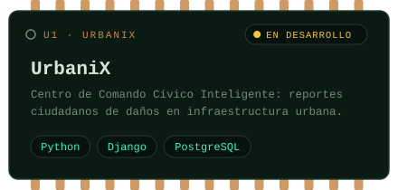
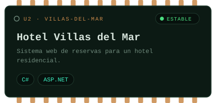
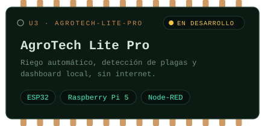
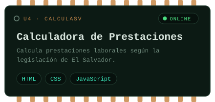



 

### `▍J1` · sobre_mí

### `▍U1–U4` · proyectos_montados

### `▍BOM` · lista_de_materiales

| Ref | Componente | Función en el circuito |
|:---:|:---|:---|
| `U1` | **Python · Django** | Backend, APIs y lógica de negocio |
| `U2` | **PostgreSQL** | Persistencia de datos |
| `U3` | **C# · ASP.NET** | Sistemas web empresariales |
| `U4` | **HTML · CSS · JavaScript** | Interfaces y apps web estáticas |
| `U5` | **ESP32 · Raspberry Pi 5** | Sensores, actuadores y procesamiento en el borde |
| `U6` | **Node-RED** | Dashboards y flujos IoT |
| `U7` | **Proteus 8** | Simulación de circuitos electrónicos |

### `▍OSC` · lecturas_del_osciloscopio

### `▍J2` · conector_de_contacto

