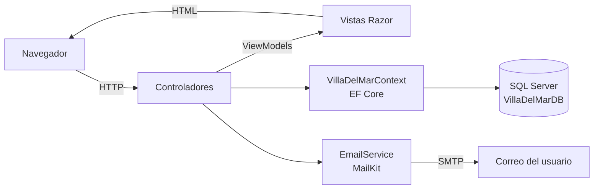
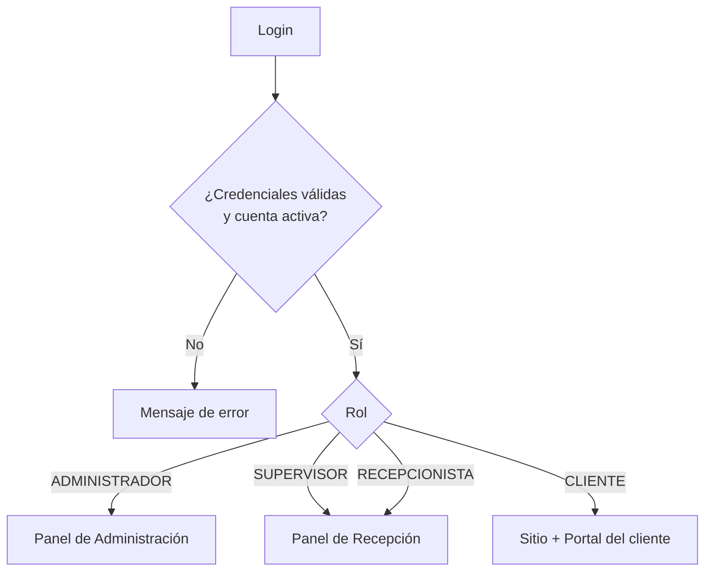
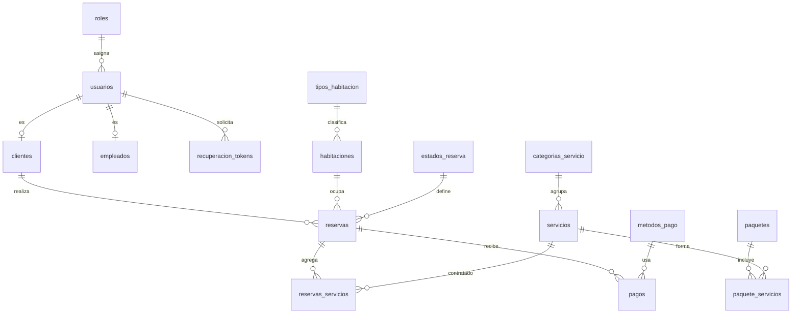

<div align="center">


# Hotel Residencial Villas del Mar

**Sistema web de reservas y gestión hotelera desarrollado con ASP.NET Core MVC y SQL Server**


</div>

<p align="center">
  
</p>

---

## Tabla de contenido

- [Descripción](#descripción)
- [Funcionalidades](#funcionalidades)
- [Capturas de pantalla](#capturas-de-pantalla)
- [Tecnologías](#tecnologías)
- [Arquitectura](#arquitectura)
- [Modelo de datos](#modelo-de-datos)
- [Instalación y ejecución](#instalación-y-ejecución)
- [Usuarios de demostración](#usuarios-de-demostración)
- [Estructura del proyecto](#estructura-del-proyecto)
- [Documentación](#documentación)
- [Lo que aprendimos](#lo-que-aprendimos)
- [Autores](#autores)

---

## Descripción

**Villas del Mar** es una aplicación web completa para la operación de un hotel residencial. Cubre todo el ciclo de una estadía: el huésped explora el sitio público, crea su cuenta, verifica disponibilidad y reserva su habitación; la recepción gestiona reservas, clientes y pagos (con ticket imprimible); y la administración controla el catálogo del hotel, los usuarios y los reportes del negocio.

El sistema trabaja con **cuatro roles** (Administrador, Supervisor, Recepcionista y Cliente), y cada uno ve un panel diferente según sus permisos.

> Proyecto final de la asignatura **Estructuras de Datos** — Universidad de El Salvador, Facultad Multidisciplinaria Oriental (noviembre 2025).

---

## Funcionalidades

### 🔐 Autenticación y seguridad
- Inicio de sesión con contraseñas cifradas con **BCrypt**.
- Registro de nuevos clientes desde el sitio.
- **Recuperación de contraseña por correo**: token aleatorio criptográficamente seguro, de un solo uso, que vence en 1 hora, enviado con MailKit por SMTP.
- Sesiones con tiempo de expiración de 60 minutos y cookie `HttpOnly`.
- Redirección automática al panel que corresponde a cada rol.
- Protección **anti-CSRF** (`ValidateAntiForgeryToken`) en los formularios del sistema.

### 🌐 Sitio público
- Páginas de Inicio, Habitaciones, Servicios, Galería (con filtros por área), Precios y Contacto.

### 🧳 Portal del cliente
- Panel con resumen de sus reservas activas y noches reservadas.
- **Nueva reserva con verificación de disponibilidad en tiempo real** (AJAX): el sistema busca una habitación libre del tipo elegido que no se traslape con otras reservas activas.
- Historial de reservas, detalle de cada una y cancelación.
- Contratación de **servicios adicionales** (spa, gastronomía, tours) dentro de una reserva activa.
- Perfil editable.

### 🛎️ Panel de Recepción (Gestor)
Disponible para los roles Recepcionista y Supervisor.
- Panel con reservas pendientes, confirmadas, check-ins en curso y reservas del día.
- Gestión de reservas: crear, editar, cambiar de estado (Pendiente → Confirmada → Check-In → Check-Out / Cancelada / No-Show) y cancelar.
- Gestión de clientes con búsqueda y paginación.
- **Registro de pagos** por reserva (efectivo, tarjeta, transferencia, PayPal) y **ticket de pago imprimible**.

### 🛠️ Panel de Administración
- Dashboard con indicadores: usuarios, clientes, reservas, pendientes, habitaciones e ingresos del mes.
- CRUD de **usuarios** con búsqueda, filtro por rol, paginación y activación/desactivación (borrado lógico).
- CRUD de **habitaciones**, **servicios** (por categoría) y **paquetes turísticos**.
- Gestión completa de **reservas**, con validación que **impide reservar una habitación en fechas que se traslapan**.
- **Reportes**: ingresos por rango de fechas, ocupación hotelera, clientes y servicios más solicitados.

---

## Capturas de pantalla

<table>
  <tr>
    <td align="center"><br/><sub><b>Inicio de sesión</b></sub></td>
    <td align="center"><br/><sub><b>Recuperación de contraseña</b></sub></td>
  </tr>
  <tr>
    <td align="center"><br/><sub><b>Dashboard de administración</b></sub></td>
    <td align="center"><br/><sub><b>Gestión de habitaciones</b></sub></td>
  </tr>
  <tr>
    <td align="center"><br/><sub><b>Reportes y estadísticas</b></sub></td>
    <td align="center"><br/><sub><b>Nueva reserva (cliente)</b></sub></td>
  </tr>
  <tr>
    <td align="center"><br/><sub><b>Servicios adicionales</b></sub></td>
    <td align="center"><br/><sub><b>Galería del hotel</b></sub></td>
  </tr>
  <tr>
    <td align="center"><br/><sub><b>Panel de recepción</b></sub></td>
    <td align="center"><br/><sub><b>Gestión de reservas</b></sub></td>
  </tr>
  <tr>
    <td align="center" colspan="2"><br/><sub><b>Ticket de pago imprimible</b></sub></td>
  </tr>
</table>

---

## Tecnologías

| Capa | Tecnología |
|------|------------|
| Backend | ASP.NET Core 8 MVC · C# |
| Acceso a datos | Entity Framework Core 8 (SQL Server provider) |
| Base de datos | Microsoft SQL Server |
| Seguridad | BCrypt.Net-Next · sesiones ASP.NET Core · tokens anti-CSRF |
| Correo | MailKit / MimeKit (SMTP) |
| Frontend | Razor Views · HTML5 · CSS3 · JavaScript · Bootstrap 5 · jQuery Validation |
| Iconos y fuentes | Font Awesome 6 · Google Fonts (Poppins) |
| Herramientas | Visual Studio 2022 · SQL Server Management Studio |

---

## Arquitectura

El proyecto sigue el patrón **Modelo-Vista-Controlador (MVC)**:



| Controlador | Responsabilidad |
|-------------|-----------------|
| `AuthController` | Login, registro, cierre de sesión, recuperación y restablecimiento de contraseña |
| `HomeController` | Sitio público: inicio, habitaciones, servicios, galería, precios y contacto |
| `ClienteController` | Portal del cliente: reservas, disponibilidad, servicios adicionales y perfil |
| `GestorController` | Recepción: reservas, clientes, pagos y tickets |
| `AdminController` | Administración: usuarios, catálogo, reservas y reportes |

**Flujo de acceso por rol**



---

## Modelo de datos

La base de datos `VillaDelMarDB` tiene 18 tablas. Las relaciones principales son:



**Catálogos incluidos en el script:** 4 tipos de habitación (Suite Estándar, Suite Deluxe, Suite Familiar, Villa Premium), habitaciones, servicios de spa, gastronomía y tours, 6 estados de reserva y 5 métodos de pago.

---

## Instalación y ejecución

### Requisitos
- [.NET 8 SDK](https://dotnet.microsoft.com/download/dotnet/8.0)
- SQL Server 2019 o superior (la edición Express funciona)
- SQL Server Management Studio (SSMS)
- Visual Studio 2022 (opcional, también funciona con `dotnet` CLI o VS Code)

### 1. Clonar el repositorio

```bash
git clone https://github.com/<tu-usuario>/hotel-villas-del-mar.git
cd hotel-villas-del-mar
```

### 2. Crear la base de datos

Abre `database/VillaDelMarDB.sql` en SSMS y ejecútalo. El script crea la base `VillaDelMarDB` con todas sus tablas y datos de demostración.

### 3. Configurar la conexión

En `ProyectoFinal/appsettings.json` la cadena de conexión apunta a una instancia local de SQL Server Express:

```json
"DefaultConnection": "Server=localhost\\SQLEXPRESS;Database=VillaDelMarDB;Trusted_Connection=True;TrustServerCertificate=True;MultipleActiveResultSets=true"
```

Si tu instancia tiene otro nombre, cambia el valor de `Server`.

### 4. Configurar el correo (para recuperar contraseñas)

Las credenciales SMTP **no se guardan en el repositorio**. Se configuran con *User Secrets* de .NET:

```bash
cd ProyectoFinal
dotnet user-secrets set "EmailSettings:FromEmail" "tu-correo@gmail.com"
dotnet user-secrets set "EmailSettings:Username"  "tu-correo@gmail.com"
dotnet user-secrets set "EmailSettings:Password"  "tu-contraseña-de-aplicación"
```

En Visual Studio también puedes hacerlo con clic derecho sobre el proyecto → **Administrar secretos de usuario**.

> Para Gmail necesitas una [contraseña de aplicación](https://support.google.com/accounts/answer/185833) (requiere verificación en dos pasos).

### 5. Ejecutar

```bash
cd ProyectoFinal
dotnet restore
dotnet run
```

O abre `ProyectoFinal.sln` en Visual Studio y presiona **F5**. La aplicación abre en la pantalla de inicio de sesión.

---

## Usuarios de demostración

El script de base de datos incluye estas cuentas, todas con la contraseña **`Cliente123`**:

| Rol | Correo |
|-----|--------|
| Administrador | `admin@villasdelmar.com` |
| Recepcionista | `recepcion@villasdelmar.com` |
| Cliente | `cliente@villasdelmar.com` |

---

## Estructura del proyecto

```
hotel-villas-del-mar/
├── ProyectoFinal.sln
├── ProyectoFinal/
│   ├── Controllers/        Admin, Auth, Cliente, Gestor y Home
│   ├── Models/             Entidades de EF Core y VillaDelMarContext
│   │   └── ViewModels/     Modelos para formularios, dashboards y reportes
│   ├── Services/           EmailService (envío de correos con MailKit)
│   ├── Views/              Vistas Razor por módulo + layouts por rol
│   ├── wwwroot/            CSS, JavaScript y librerías del cliente
│   ├── Program.cs          Configuración de servicios y pipeline
│   └── appsettings.json
├── database/
│   └── VillaDelMarDB.sql   Script de creación de la base con datos de demo
└── docs/
    ├── manuales/           Manual de usuario, de administración e investigación
    └── screenshots/        Capturas usadas en este README
```

---

## Documentación

- 📘 [Manual de Usuario](docs/manuales/Manual-de-Usuario.pdf) — guía paso a paso de cada módulo.
- 📗 [Manual de Administración](docs/manuales/Manual-de-Administracion.pdf) — arquitectura, requisitos técnicos y despliegue.
- 📙 [Trabajo de Investigación](docs/manuales/Trabajo-de-Investigacion.pdf) — marco teórico (ASP.NET Core, MVC, SQL Server, EF Core) y metodología.

---

## Lo que aprendimos

- Diseñar una aplicación **MVC por capas** con controladores separados por rol.
- Modelar una base de datos relacional y mapearla con **Entity Framework Core** (Fluent API, relaciones y `Include`).
- Resolver un problema real de reservas: **detectar traslapes de fechas** para no asignar dos veces la misma habitación.
- Implementar un flujo seguro de **recuperación de contraseña** con tokens de un solo uso y envío por SMTP.
- Aplicar buenas prácticas de seguridad: hash de contraseñas, anti-CSRF y secretos fuera del código fuente.

---

## Autores

| | Integrante |
|---|---|
| 👨‍💻 | **Abraham Bladimir Umanzor Vásquez** |
| 👨‍💻 | **Bryan Arturo Hernández Gutiérrez** |

**Asignatura:** Estructuras de Datos · **Docente:** Ing. César Misael Franco Rodríguez
Universidad de El Salvador — Facultad Multidisciplinaria Oriental, Sección de Sistemas Informáticos · Noviembre 2025

---

<div align="center">
<sub>Proyecto académico. Las imágenes y datos del hotel son de demostración.</sub>
</div>
